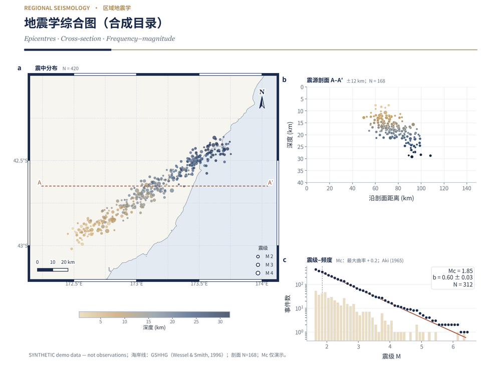

# Shanhai Atlas · 山海图

> 一套设计令牌，从论文图件到汇报 PPT。
> 面向**地理 / 地质 / 地形 / 地震**的可复现科研出图工具包。



**English.** Shanhai Atlas is a Python toolkit for publication-ready geoscience figures. It builds regional maps, terrain hillshades and profiles, structural-geology and seismology plots, journal-style multi-panel figures, and matching slide decks — all from one design system, with editable SVG/PDF output and a built-in layout audit. It is built on matplotlib + NumPy + fontTools; every heavy dependency is optional.

---

## 为什么用它

科研出图最耗时的往往不是画图，而是**反复对齐版式、中文断行、导出格式和投稿规范**。山海图把这四件事收敛成代码：

| 痛点 | 山海图的做法 |
|---|---|
| 图件风格不统一 | 一套设计令牌（黛蓝 `#1B2A4A` × 古铜金 `#B08D57`）贯穿地图、剖面、统计图、PPT |
| 中文换行 / 避头尾 / 越界 | `Canvas` 按英寸排版，用实测字形宽度断行；`audit()` 报出越界与压字 |
| SVG 转曲后 Illustrator 改不了字 | 默认导出**可编辑** SVG：保留 `<text>`、内嵌字体子集；PDF 保留文字层 |
| 投稿前反复查期刊规格 | `journal_preset()` + `check_journal()` / `check_export()` 给出可执行体检 |
| 图里数字靠手填 | 脚本生成，全部数值来自程序输出并可用 `assert` 锁定 |
| 依赖沉重 | 必需依赖只有 3 个；可选依赖缺失一律降级，不换绘图引擎 |

**它不是** GMT / PyGMT / cartopy 的替代品：内置 `GeoMap` 只做小范围区域等距圆柱近似（建议单幅跨度 ≤ 15°）。跨区、全球或需严格投影时请用专业制图库，再把它产的图件放进本工具的版面。

---

## 能力矩阵

| 类别 | 能力 | 主要模块 |
|---|---|---|
| 🌏 地理 | GSHHG 海岸线（裁剪 + RDP 化简）、经纬网、斑马图框、比例尺、指北针、位置图、GeoJSON / Shapefile、位移向量 | `geo` |
| ⛰ 地质 / 地形 | DEM 读取（GeoTIFF / ASC / NetCDF / NPZ）、Terrarium 在线瓦片、多方向山体阴影、分层设色、等高线、A–A′ 剖面、正交三维点云 / 面片、下半球等面积极点图 | `terrain` `proj3d` `stereonet` |
| 🌋 地震 | CSV 目录读取（列名自动识别）、USGS ComCat 查询与来源记录、震中图、震源剖面、Mc（最大曲率）/ Aki b 值、震级–频度、三维震源机制球 | `seismic` `beachball3d` |
| 📊 科研绘图 | 整页英寸版面、卡片 / 公式框 / 数据流、期刊双栏多面板、训练曲线 / ROC / PR / 混淆矩阵 / 消融表 / 注意力热图、标签避让、显著性括号 | `canvas` `components` `charts` `mlfigs` `adapters` |
| ✨ 导出与质量 | 可编辑 SVG / PDF / PNG、公式 Unicode 化、缺字回退、字体子集内嵌、`<text>` / `FontFile2` 体检、8 家期刊预设 | `exporter` `textnorm` `journal` |
| 📑 汇报 | 同风格 PPT：封面、章节、整页矢量图、卡片、表格、KPI、讲稿备注；无 Office 版面预览 | `ppt` `ppt_preview` |

---

## 安装

```bash
pip install shanhai-atlas
# 或装齐常用可选依赖（海岸线 / PPT / 栅格 / NetCDF / Shapefile / ObsPy）
pip install "shanhai-atlas[all]"

python -m shanhai_atlas doctor      # 自检：字体、可选依赖、GSHHG 海岸线
python -m shanhai_atlas fonts       # 可选：下载 Noto Sans SC + Source Serif 4（SIL OFL，约 35 MB）
```

必需依赖：`numpy>=1.24`、`matplotlib>=3.7`、`fonttools>=4.40`。
可选 extras：`[geo]` 海岸线 · `[ppt]` PPT · `[tiff]` GeoTIFF · `[netcdf]` NetCDF/GMT grd · `[shapefile]` Shapefile · `[seismo]` ObsPy。
不下载字体也能运行，会自动回退到系统里的思源黑体 / 微软雅黑 / 苹方。

> **环境提示**：若使用 `[tiff]`，建议保持 `numpy<2` 且 `tifffile<=2026.2.16`。本项目**不提供** `rasterio` extra —— 它会把 NumPy 顶到 2.x 并破坏这套组合；确有 GeoTIFF CRS 需求时请在独立环境自行安装。

---

## 5 分钟上手：一张震中图

`events.csv` 只需 `lon,lat,depth_km,magnitude` 四列（列名自动识别，`time`、`event_id` 可选）。
可用 `examples/_synthetic.py` 里的 `write_csv()` 生成一份示意数据。

```python
import shanhai_atlas as sha
from shanhai_atlas.geo import GeoMap

sha.setup()                                        # 注册字体 + 可编辑矢量 + 可复现 SVG
cat = sha.read_catalog("events.csv")

cv = sha.Canvas(12, 8)                             # 英寸坐标，左上原点
sha.header(cv, "SEISMIC EVENTS  ·  震中分布", "区域地震分布图", "Epicentre map")

ax = cv.inset(0.6, 1.4, 10.8, 6.2)
m = GeoMap(ax, (172.30, 174.00, -43.10, -42.10))  # (W, E, S, N)
m.coast("h")                                       # 需 [geo]；未安装则跳过此行
m.graticule(0.25); m.ticks(0.5); m.zebra(0.5)
pts = sha.plot_events(ax, cat, color_by="depth_km")
cv.fig.colorbar(pts, ax=ax, label="深度 (km)")
m.scale_bar(25); m.north_arrow()

cv.audit()                                         # 0 越界 / 0 压字 为合格
cv.save("eq_map")                                  # → eq_map.pdf + eq_map.svg + eq_map.png
```

---

## 四类核心用法

<details open>
<summary><b>地理 / 地质底图</b></summary>

```python
from shanhai_atlas.geo import GeoMap, locator
from shanhai_atlas.theme import C, SERIES

m = GeoMap(ax, (172.30, 174.00, -43.10, -42.10))
m.coast("h"); m.graticule(0.25); m.ticks(0.5); m.zebra(0.5)
ax.plot(fault_lon, fault_lat, color=SERIES[0], lw=1.5)   # 断层迹线
m.points(station_lon, station_lat, s=18, c=C.navy)        # 台站
m.vectors(lon, lat, east_km, north_km, key_km=10)         # GNSS 位移
m.geojson(feature_collection)                             # GeoJSON 叠加
m.scale_bar(25); m.north_arrow()
```
</details>

<details>
<summary><b>地形晕渲与剖面</b></summary>

```python
from shanhai_atlas import terrain

dem = terrain.sample_dem("jacksboro")        # 离线样例；或 load_dem("dem.tif")
# dem = terrain.fetch_terrarium((W, E, S, N))  # 在线 Terrarium 瓦片，需联网并署名
terrain.draw(ax, dem, sea=True, strength=0.55, cmap="sha.terrain")
terrain.contours(ax, dem, interval=100.0)
prof = terrain.profile(dem, (lon0, lat0), (lon1, lat1))
```
</details>

<details>
<summary><b>地震学三件套</b></summary>

```python
cat = sha.read_catalog("events.csv", source="my catalog")
sha.plot_events(ax, cat, color_by="depth_km", size_range=(5, 25))
section = sha.plot_cross_section(ax2, cat, (lon0, lat0), (lon1, lat1),
                                 half_width_km=12, depth_limits_km=(0, 40))
mfd = sha.plot_magnitude_frequency(ax3, cat.magnitude)   # .mc / .b_value / .sigma_b
mc = sha.estimate_mc_max_curvature(cat.magnitude)
b, sigma_b, n = sha.aki_b_value(cat.magnitude, mc)
sha.beachball3d(ax4, strike=30, dip=60, rake=-90, az=25, el=15)  # 纯 numpy，不需 ObsPy
```
</details>

<details>
<summary><b>科研多面板与期刊体检</b></summary>

```python
from shanhai_atlas import journal, mlfigs

cv = sha.Canvas(7.48, 5.51)                     # 期刊双栏
ax = cv.inset(0.48, 1.28, 3.2, 1.72)
sha.panel_label(ax, "a"); sha.style_axes(ax, grid="y")
mlfigs.roc_curves(ax, curves={"model A": (y_true, y_score)})

report = journal.check_journal(cv, preset="nature", raster_dpi=300)
print(report["ok"], report["errors"], report["warnings"])
# 导出后核对产物：
journal.check_export("figure.svg", preset="nature")
```
</details>

完整 API 见 [`docs/API.md`](docs/API.md)。

---

## 可编辑矢量导出

`cv.save()` 默认同时写出 **PDF + SVG + PNG**（PNG 300 dpi）。0.2 起默认文字模式为 `editable`：

| 模式 | SVG | PDF | 适用 |
|---|---|---|---|
| `editable`（默认） | 保留 `<text>`，内嵌实际用到的字体子集 | 保留文字层（`/FontFile2`） | Illustrator 里直接改字、投稿 |
| `outline` | 文字转曲 | 文字层由 Ghostscript 转曲 | 零字体依赖的保底交付 |
| `both` | 两种都给（`.outline.svg` 另存） | 两种都给 | 交稿同时留保底 |

```python
cv.save("figure", text_mode="editable", font_embed="subset", strict_text=True)
```

`strict_text=True` 会在导出后调用 `assert_editable()`：没有真文字就抛错，适合 CI / 交稿前守门。
`exporter.svg_report()` / `pdf_report()` 给出可读数证明，而不是"看着像矢量"：

- 本仓库示例 `ex06_seismology.svg` 实测：**62 个 `<text>`、59 个纯文本元素、9 个 `tspan`、3 个 `@font-face` 内嵌子集**，`assert_editable()` 通过。
- PDF 体检会数 `/FontFile2` / `Type3` / `ToUnicode` 并揪出 `LastResort`（豆腐块）。

> 已知边界：字体子集只包含**图中实际出现**的字，事后在 AI 里新增汉字可能掉字 —— 交稿前定稿，或用 `text_mode="both"` 附转曲保底版。`\sqrt{}` 等无法无损转 Unicode 的公式会保留 mathtext 分段。

---

## 数据与合规

**本仓库不包含任何真实地震编目、台站坐标或观测数据。**

- `examples/_synthetic.py` 生成的所有事件、断层迹线、台站位置均为**固定随机种子的合成示意数据**，不是任何机构发布的目录，不能用于科学结论。
- 示例区域为海外公开研究区，**不加载任何行政边界、国界或未公开敏感坐标**；底图只用 GSHHG 海岸线。
- 真实研究请自备**已获授权**的数据，通过 `read_catalog()` 传入；工具不替使用者判断数据授权。
- `fetch_usgs_catalog()` 查询的是 USGS ComCat 公开服务，会保存 URL / 参数 / 访问时间到 `.meta.json`；引用须按其服务元数据。
- GSHHG 海岸线（LGPL-3.0）、AWS Terrain Tiles / Terrarium（按数据源署名）、字体（SIL OFL）各自有许可义务，详见 [`THIRD_PARTY.md`](THIRD_PARTY.md) 与 [`docs/DATA_POLICY.md`](docs/DATA_POLICY.md)。

---

## 命令行

```bash
python -m shanhai_atlas doctor                 # 环境自检
python -m shanhai_atlas fonts                 # 下载默认字体
python -m shanhai_atlas gallery               # 跑全部示例（仓库内）
python -m shanhai_atlas preview deck.pptx     # 无 Office 预览 PPT 版面
python -m shanhai_atlas fetch-usgs --extent 172.1 174.2 -43.2 -42.0 \
    --start 2016-11-13 --end 2016-12-31 --min-magnitude 2.5 --out events.csv
```

---

## 示例与测试

```bash
python -m shanhai_atlas gallery --out output    # 一次跑完 6 个示例
python -m pytest -q                            # 114 passed, 1 skipped
```

| 脚本 | 覆盖 | 数据 |
|---|---|---|
| `ex01_structure_figure.py` | 16:9 模型结构 / 技术路线图 | matplotlib 自带 DEM 样例 |
| `ex02_geo_map.py` | 地理底图 + 断层 + 震中 + 台站 + 位置图 | 合成 + GSHHG 海岸线 |
| `ex03_terrain_map.py` | 地形晕渲、等高线、A–A′ 剖面、坡度统计 | matplotlib 自带 DEM 样例 |
| `ex04_data_panels.py` | 期刊双栏四面板 | 合成 |
| `ex05_deck.py` | 同风格 PPT（SVG 矢量 + PNG 回退 + 讲稿） | 合成；需 `[ppt]` |
| `ex06_seismology.py` | 震中图 + 剖面 + 震级–频度 | 合成，或 `--catalog` 传自己的 CSV |

说明见 [`examples/README.md`](examples/README.md)。

---

## 边界与已知限制

- **投影**：`GeoMap` 是区域等距圆柱近似，不做全球图、跨日期变更线、自动 CRS 识别或高精度椭球测地；跨度 > 15° 请用 GMT / PyGMT / cartopy。
- **栅格**：DEM 坐标必须与图幅一致，工具不静默重投影。
- **网络数据**：Terrarium 瓦片与 USGS ComCat 需联网，走官方 URL + 本地缓存；离线环境请使用本地 DEM / CSV。
- **期刊预设**：8 家出版方规格均带 `verified=False`，数字可能过期，请对照官网复核后修改 `journal.PRESETS`。
- **PPT**：SVG 矢量嵌入需 PowerPoint 2016 / 365；WPS 与旧版 Office 显示 PNG 回退图。`preview` 只检查几何与溢出，不是精确渲染。
- **定位**：这是**出图与排版工具**，不是地图服务、不替代专业 GIS，也不提供在线底图瓦片服务。

---

## 文档

| 文件 | 内容 |
|---|---|
| [`docs/API.md`](docs/API.md) | 核心 API 速查 |
| [`docs/DESIGN.md`](docs/DESIGN.md) | 设计规范：配色、字体、信息密度、质量门槛 |
| [`docs/DATA_POLICY.md`](docs/DATA_POLICY.md) | 数据合规、来源署名、自备数据责任 |
| [`THIRD_PARTY.md`](THIRD_PARTY.md) | 第三方依赖 / 数据 / 字体 / 算法与许可 |
| [`CHANGELOG.md`](CHANGELOG.md) | 版本变更 |
| [`CONTRIBUTING.md`](CONTRIBUTING.md) | 贡献指引 |

## 许可

**MIT** — 见 [`LICENSE`](LICENSE)。第三方数据、字体与依赖仍按各自许可使用，不受本项目许可影响。

> 版本 0.2.0 · 核心模块 23 个 · 测试 114 项通过 / 1 项按环境跳过。
